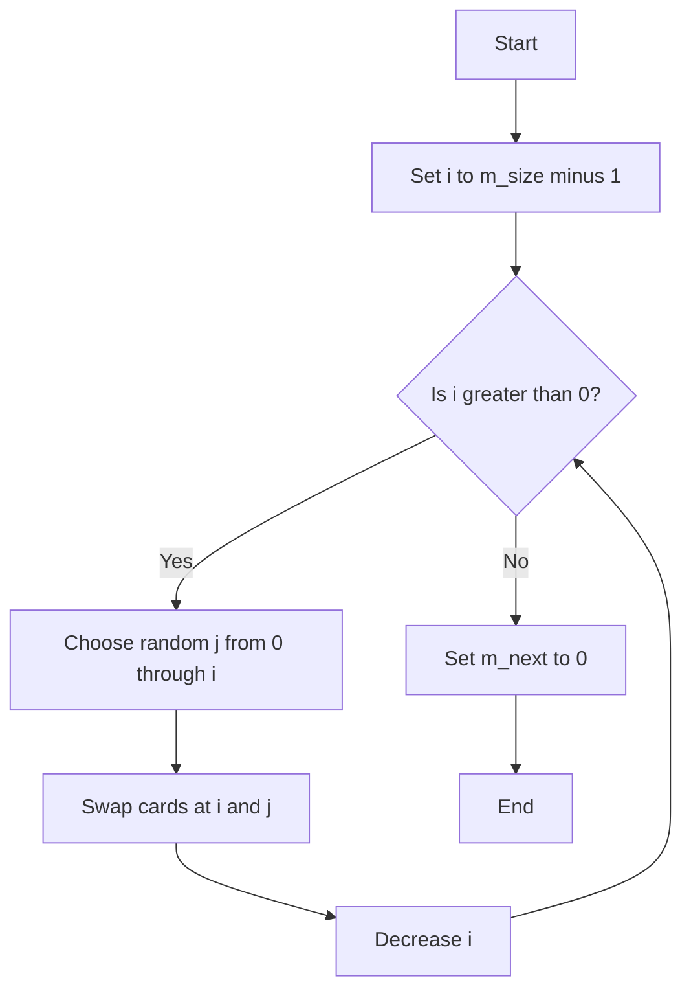
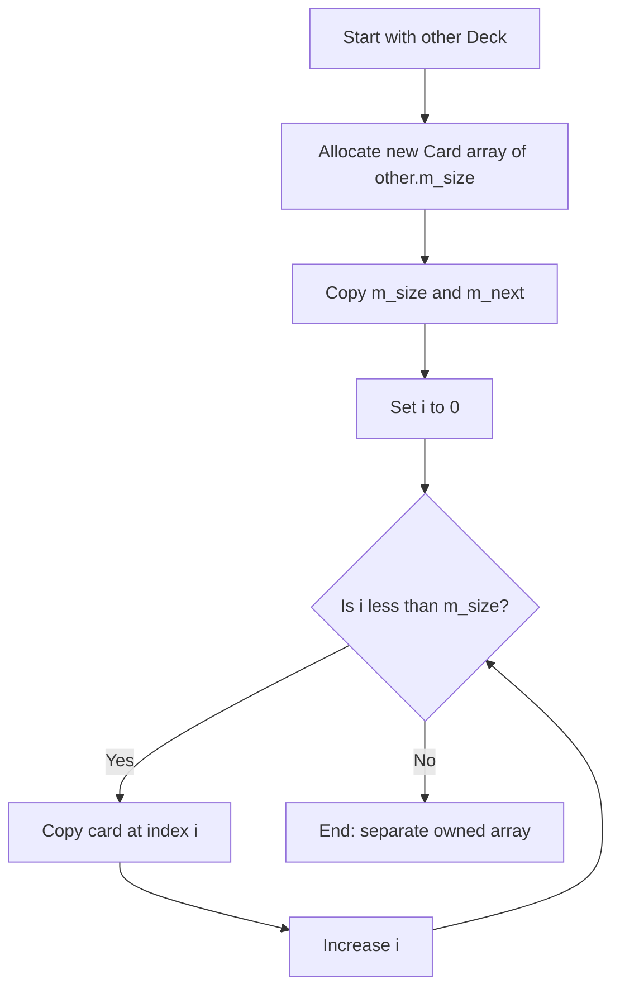
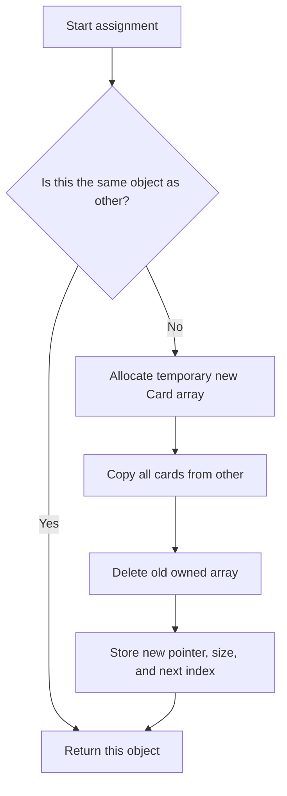

# Lab 10: memory diagrams and flowcharts

## Shallow copy (unsafe)

```text
original.m_cards ----+----> [Card 0] [Card 1] ... [Card 51] (heap)
                     |
backup.m_cards ------+

Both objects own the same pointer. Destroying both causes double deletion.
```

## Deep copy (safe)

```text
original.m_cards --------> [Card 0] [Card 1] ... [Card 51] (heap A)
backup.m_cards ----------> [Card 0] [Card 1] ... [Card 51] (heap B)

Each Deck owns a separate array; changing one does not change the other.
```

## Shuffle (Fisher–Yates)



## Copy constructor



## Copy assignment


